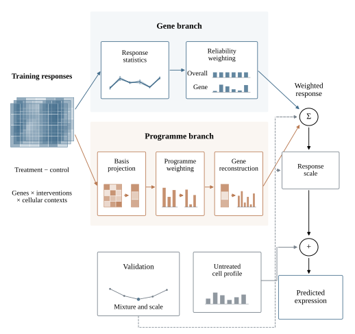

# scPerturbMix

**Single-cell perturbation response modelling**

Current release: **0.5.0**.

[](LICENSE)
[](pyproject.toml)

scPerturbMix models changes in gene expression caused by chemical, immune and genetic perturbations. It combines gene-level responses with coordinated gene programmes to predict cellular responses under different cell identities, donor backgrounds and treatment conditions. The research evaluation covers drug responses, immune stimulation, dose dependence and genetic interventions.



## How the response model works

The main model uses **statistical machine learning**: it combines shared responses, reliability weighting and a learned low-dimensional representation. Held-out training contexts select how much each component contributes. The released predictor runs on a CPU with NumPy. Optional neural reference code is provided separately.

For each treatment, the model estimates a shared response and measures how consistently that response occurs across source contexts. It combines estimates at the treatment, gene and response-programme levels. A programme is a low-dimensional direction learned from coordinated variation in source responses. Hallmark gene sets are used separately to interpret and evaluate biological responses.

The released response-transfer checkpoints return a treatment-induced change, `effect`, and an absolute expression prediction, `prediction = target_control + effect`. The supplied untreated target profile supplies the final expression baseline. Changing that profile changes the absolute prediction while leaving the core model's treatment effect unchanged. The separately evaluated target-context kernel extension uses untreated cell-state information to change the predicted effect itself. Its study-level analyses are described in the [benchmark guide](docs/benchmark_evidence.md).

See [data and prediction tasks](docs/data_and_tasks.md) for the biological meaning of each dataset, its training and evaluation roles, and the distinction between the released checkpoints and the broader research evaluation.

## Install

The Python package and import name are `scperturbmix`. Its command-line tools are `scperturbmix-fit` and `scperturbmix-predict`.

```bash
git clone https://github.com/Qiu-Shizheng/scPerturbMix.git
cd scPerturbMix
python -m venv .venv
source .venv/bin/activate
python -m pip install -e .
```

## Predict with a fitted model

```bash
scperturbmix-predict \
  --model-dir models/response_transfer/op3_programs \
  --control models/response_transfer/op3_programs/example_control.csv \
  --conditions models/response_transfer/op3_programs/example_conditions.csv \
  --output predictions.npz
```

The example uses a source control to demonstrate the file format. For your experiment, supply an untreated target control on the model's gene axis and expression scale. These checkpoints predict the drug, dose and exposure-time combinations listed in their model files.

| Model | Response genes | Fitting and evaluation setting |
|---|---:|---|
| [OP3 response transfer](models/response_transfer/op3) | 5,317 | B, T and NK source cells; myeloid evaluation from shared donors |
| [OP3 refined response transfer](models/response_transfer/op3_refined) | 5,317 | Wider source-only reliability search with analytic response scaling |
| [OP3 gene and programme model](models/response_transfer/op3_programs) | 5,317 | Parallel gene and learned-programme reliability, with source-only selection |
| [Cellarity response transfer](models/response_transfer/primary) | 13,290 | Six cultured source lines; four primary-cell populations |
| [Glioblastoma expression](models/expression) | 512 | A172 fitting, T98G selection and U87MG development evaluation |
| [Mouse cytokine responses](models/response_transfer/immune_dictionary) | 2,000 | Six lymphoid source populations, 83 named cytokine conditions, six external target populations |

Drug checkpoints predict their listed drug–dose–time conditions. The mouse cytokine checkpoint accepts registered condition identifiers, with dose and exposure recorded in its catalogue. The expression model has a separate command documented in its [README](models/expression/README.md).

## Predict mouse cytokine responses

The mouse checkpoint predicts the 83 named cytokine conditions in its catalogue. It uses the source-fitted model evaluated in the [Immune Dictionary study](docs/external_validation.md).

```bash
scperturbmix-predict \
  --model-dir models/response_transfer/immune_dictionary \
  --control models/response_transfer/immune_dictionary/example_control.csv \
  --conditions models/response_transfer/immune_dictionary/example_conditions.csv \
  --output mouse_cytokine_predictions.npz
```

The condition file needs only a `condition_id` column. The supplied example uses a matched PBS control from the evaluated plasmacytoid dendritic-cell population. For an experiment, provide its matched untreated target profile. In the Python API, `predict_conditions` also accepts a matrix containing one matched control for each requested condition.

The model uses mouse gene identities and cell-level log1p counts per 10,000. Normalise across the complete 31,053-gene count axis first, then select the 2,000 model genes. Average cells within each mouse and then weight mice equally. The catalogue keeps the original dose of 5 micrograms per mouse and four-hour exposure. See the [named-condition guide](docs/response_transfer.md#named-cytokine-conditions) for a complete Python example and matched-control input shapes.

## Input and output

The control CSV contains `gene_id,expression`, with exactly the model gene set and one row per gene in any order. For drug checkpoints, the condition CSV contains:

```csv
condition_id,drug,dose_uM,time_hours
```

Choose supported combinations from the model's `model.json` or copy its example condition file. Drug doses are in micromolar and exposure times are in hours. The mouse cytokine checkpoint uses a one-column `condition_id` CSV. Its catalogue records 5 micrograms per mouse and a four-hour exposure. The CLI reads the appropriate condition format from the model metadata.

The output NumPy archive contains:

| Array | Meaning |
|---|---|
| `prediction` | Predicted expression, conditions × genes |
| `effect` | Predicted change relative to the supplied control |
| `gene_ids` | Gene order of both output matrices |
| `condition_id` | Input condition identifiers |

OP3 inputs use log1p counts per million across the 5,317 released genes. Cellarity inputs use the original released expression scale. See the [model guide](docs/response_transfer.md) for compatible preprocessing and evaluation scope.

## Python API

```python
from scperturbmix import predict_response

prediction, effect, output_genes = predict_response(
    control=control_vector,
    gene_ids=gene_ids,
    compounds=compound_names,
    doses_uM=doses,
    times_hours=exposure_times,
    model_dir="models/response_transfer/op3_programs",
)
```

The control may be one gene vector or one vector per condition. Use `predict_conditions(control, gene_ids, condition_ids, model_dir)` for the named mouse cytokine conditions. Both interfaces return predicted expression, response effects and genes in model order.

## Fit your own response model

Provide a NumPy archive containing `effects` with shape **source contexts × shared conditions × genes**, plus `gene_ids`, `drug`, `dose_uM` and `time_hours`. Each effect is measured relative to its matched untreated source control. At least three source contexts are required.

```bash
scperturbmix-fit \
  --source-effects source_effects.npz \
  --input-scale "log1p CPM across the declared gene panel" \
  --output models/my_response_model
```

The fixed search selects the reliability penalty, compound–gene mixture and response scale by leaving out source contexts. It writes the fitted model and all candidate validation scores. Target treated expression is not an input to this interface.

To fit the gene and programme architecture, install its SciPy fitting dependency and select the programme search:

```bash
python -m pip install -e '.[programs]'
scperturbmix-fit \
  --source-effects source_effects.npz \
  --input-scale "log1p CPM across the declared gene panel" \
  --search programs \
  --output models/my_programme_model
```

The programme basis is learned anew inside each source-validation fold. Selection includes a gene-only option. Saved programme models use the same `scperturbmix-predict` command and require only NumPy for inference. At inference, the gene panel, expression transformation, drug identity, dose and exposure time must match the fitted model's input contract.

## Task support

A fitted response model can predict a batch of supported perturbation conditions in one call. Drug, immune-stimulation, dose and genetic-response experiments use the components and fits appropriate to their inputs. The research framework evaluates several tasks, with separate fitting for each task. The released command-line model fits gene and programme responses and predicts the conditions stored in a checkpoint. See the [task guide](docs/task_support.md) for the available interfaces and experiment roles.

## Research tasks and data

The research evaluation includes **12 experiments from 11 original studies**: 11 are derived from single-cell measurements and one is a bulk RNA-sequencing auxiliary experiment. Most endpoints are average expression responses for a cell population under a defined treatment.

| Task | Datasets | Prediction target |
|---|---|---|
| Drug responses across cell contexts | OP3 immune-cell drug screen; Cellarity primary-cell drug atlas | Treated myeloid or primary-cell populations |
| Immune responses across donors and cell types | Kang interferon-beta, Parse cytokines, Wood stimulation, mouse Immune Dictionary | Human monocyte responses in a held-out donor, or mouse macrophage and dendritic-cell responses in held-out populations |
| Dose response | sci-Plex2 lung-cell dose series; sci-Plex3 cancer-cell dose screen | Responses at held-out concentrations |
| Genetic perturbations across environments | Glioblastoma kinome screen, PerturbFate, primary CD4 T-cell panel | Responses in a held-out cell background, target-gene group or donor |
| Prediction after a small pilot experiment | Parse blood-cell cytokine screen; Wood blood-cell stimulus panel | Remaining stimuli after observing a few target-context responses |

The pilot task reuses two studies. The diffuse midline glioma PLATE-seq screen provides a separate bulk-expression check. sci-Plex2 and sci-Plex3 come from the same original study.

In most external-study evaluations, a model is fitted to permitted source cells from that study and predicts its held-out targets. Transferring a fixed parameter-selection rule still allows source-response coefficients to be fitted in the new study. These roles are recorded in the [dataset guide](docs/data_and_tasks.md) and [downloadable cohort table](docs/data/cohort_roles.tsv). Immune-stimulation experiments measure cellular responses to immune signals.

## Evaluation

In the OP3 development task, the hierarchical gate has MSE **0.074658** and mean response Pearson correlation **0.224**, compared with **0.075912** and **0.193** for the separately selected compound-only gate. The comparison uses 127 drugs and the same 5,317 response genes. Cellarity effects vary by population. The [model guide](docs/response_transfer.md) reports the complete population comparison and scope.

The optional refined OP3 model has MSE **0.074393** and response correlation **0.225**, compared with **0.075823** for a compound-only model selected using the same wider search. Use `--search extended` with `scperturbmix-fit` to apply this fitting procedure to your own source profiles. The original model and default search remain available for reproduction.

The gene and programme model has MSE **0.073151** and response correlation **0.252**, a **3.52%** MSE reduction relative to the extended compound-only model on these same conditions. This result evaluates transfer between cell types represented in shared donors. The benchmark guide also evaluates jointly held-out donors and cell types.

The [unified benchmark comparison](docs/benchmark_comparison.md) presents all evaluated classical methods, single-cell perturbation models and pretrained-model adaptations together within each of eleven matched task groups. It includes scGen, scVIDR, CPA and biolord on the interferon task, plus scGPT, Nicheformer and Geneformer V1/V2 encoder adaptations on immune-cell drug responses. Native, control-anchored, frozen, fine-tuned and random-control settings retain their explicit labels.

The [mechanism guide](docs/mechanism_evidence.md) explains gene and programme weighting, component removals and classical shrinkage comparisons. The [external evaluation guide](docs/external_validation.md) describes the mouse Immune Dictionary: 438 eligible response conditions across six held-out populations, with all eight compared models and published immune-signature analysis. Model selection uses source populations within that study.

Downloadable tables retain every evaluated result. Gene panels, normalisation, available target information and evaluation units differ between tasks. The [detailed evidence](docs/benchmark_evidence.md) describes those settings and the additional donor, pilot-response and biological-programme analyses.

Saved models replay the frozen evaluation predictions to numerical precision. Run the software tests with:

```bash
python -m unittest discover -s tests -v
```

For H5AD loading, the synthetic training runner and optional PyTorch modules, see the [reference implementation guide](docs/user_guide.md).

## Data and citation

The repository includes fitted model parameters and example inputs. Obtain experimental expression matrices from the original studies:

- [OP3, NeurIPS 2024](https://doi.org/10.52202/079017-0650)
- [Cellarity compound-response atlas](https://doi.org/10.1126/science.adi8577)

The [dataset guide](docs/data_and_tasks.md) links every study in the research evaluation and explains the analysed subset. See [CITATION.cff](CITATION.cff) to cite the software. Code is distributed under the [MIT License](LICENSE). Original datasets retain their source licences.
